# Oryn OS

**An operating system for your AI workforce.** Oryn OS is a multi-tenant platform where a business
connects its CRM, email, phone, calendar, billing, documents and internal database, then deploys
specialized AI agents that run real operational workflows end to end: qualifying leads, booking
appointments, answering support tickets, chasing invoices, writing reports. A durable orchestrator
coordinates the agents, keeps every run's state, retries what fails, and stops to ask a human before
anything risky happens.

It runs **fully offline with one command and no API keys**. Real providers (Claude, Twilio, SMTP)
switch on with environment variables.

**Try it live: [oryn-os-silk.vercel.app](https://oryn-os-silk.vercel.app)**. The website and the full
dashboard run in your browser, with no sign-up. Click *Open the app*, then *Sign in* (any password
works). The hosted copy replays a recording of the real system: two weeks of runs, a discount waiting
for your approval, and simulated runs you can start yourself. It needs no backend, so nothing you do
there touches real data.

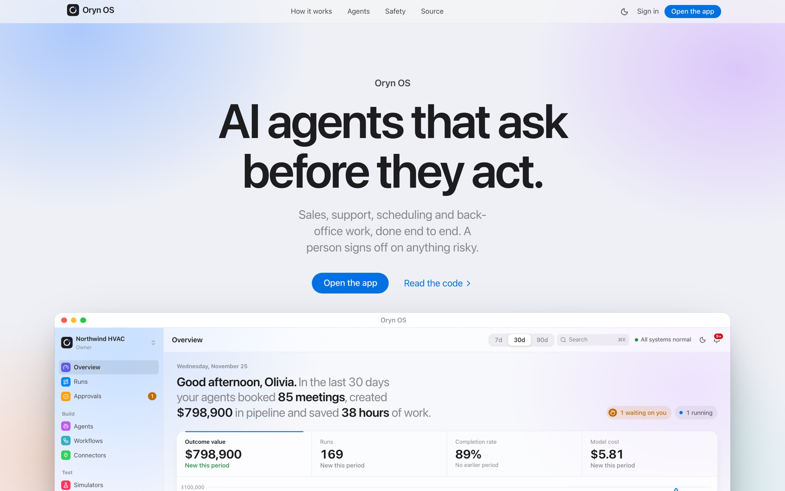

## A tour

<table>
<tr>
<td width="50%">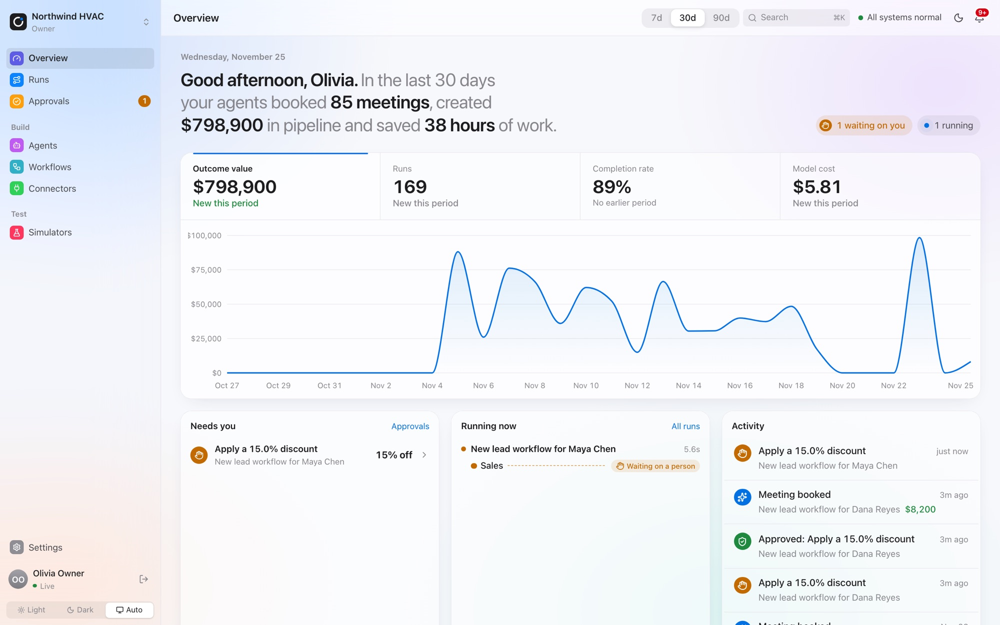<br><b>Overview.</b> One sentence on how the period went, metric tabs that drive a single chart, then what needs you, what's running and recent activity.</td>
<td width="50%">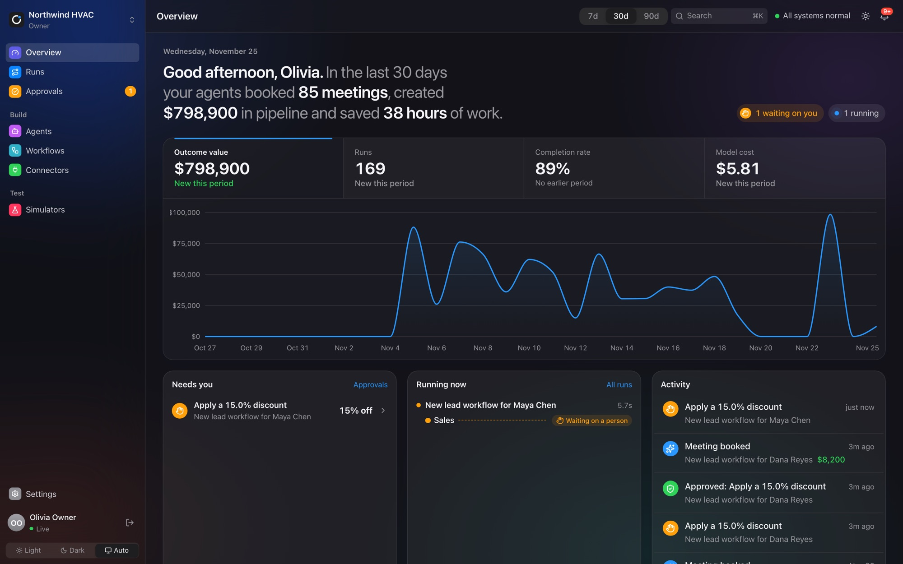<br><b>Light and dark.</b> A sun/moon switch on the website and in the app, shared across both, over a frosted-glass background.</td>
</tr>
<tr>
<td><br><b>Runs.</b> A list pane with search and status filters next to an inspector: the route between agents, duration, cost, tokens and outcome, and the full span trace. <kbd>J</kbd>/<kbd>K</kbd> move through runs.</td>
<td>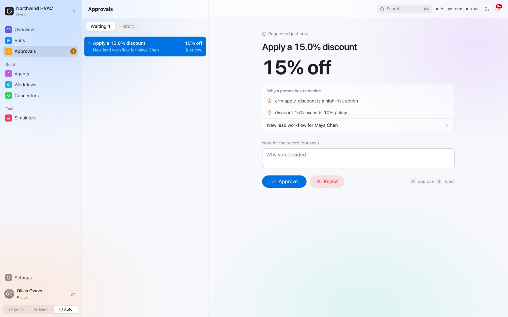<br><b>Approvals.</b> Every request says why a person has to decide (the policy it crossed). <kbd>A</kbd> approves, <kbd>R</kbd> rejects, and the next request opens.</td>
</tr>
<tr>
<td>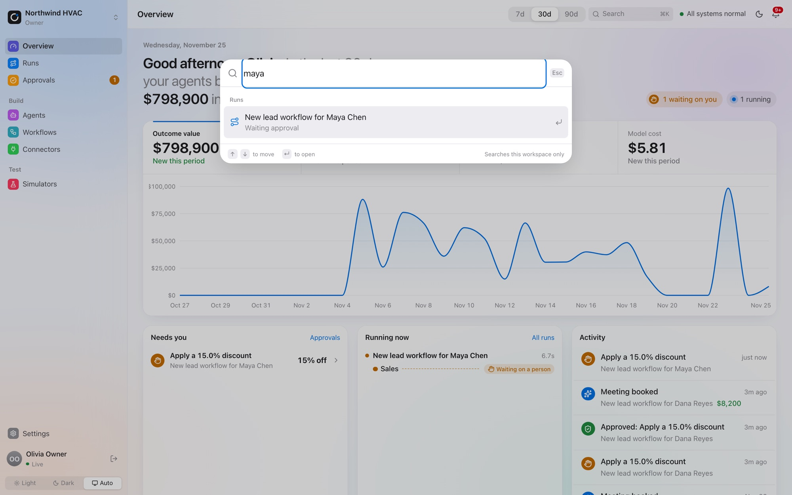<br><b>Command menu.</b> <kbd>⌘</kbd><kbd>K</kbd> searches the workspace and does things: go anywhere, fire a simulated event, start a workflow, switch business or theme.</td>
<td>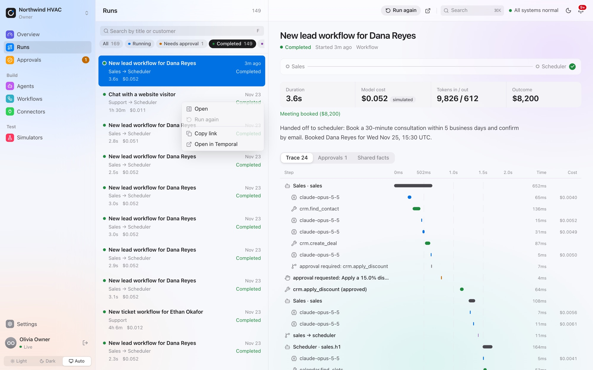<br><b>Context menus.</b> Right-click a run to open it, run it again, copy its link or jump to it in Temporal.</td>
</tr>
<tr>
<td>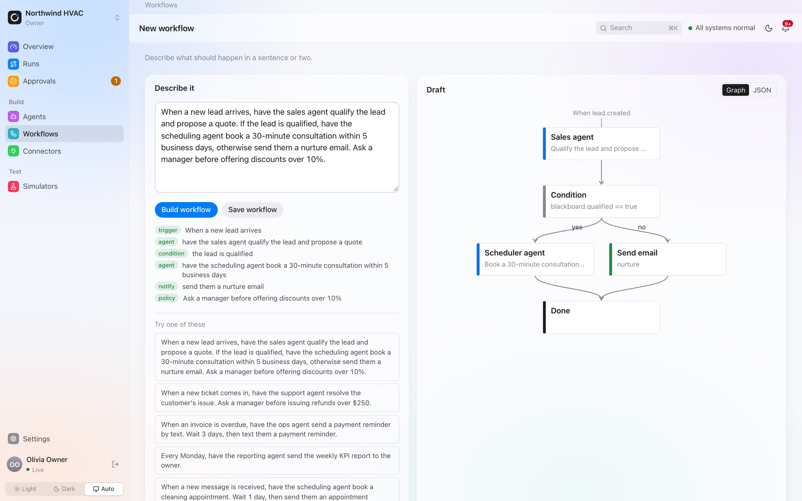<br><b>Workflow builder.</b> Describe a workflow in a sentence or two. Oryn drafts the graph, conditions and approval policy for you to save.</td>
<td>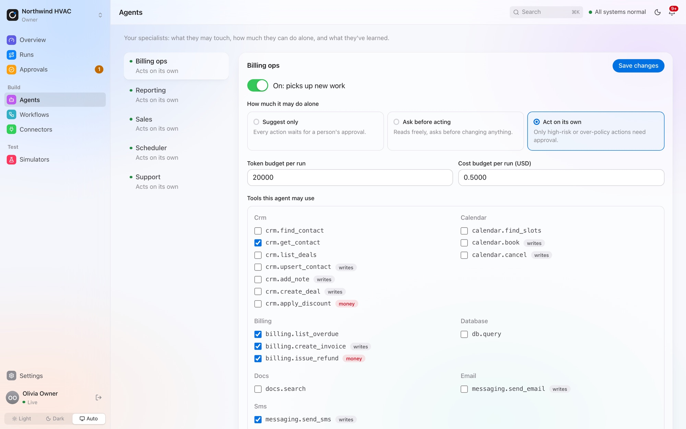<br><b>Agents.</b> For each specialist: how much it may do alone, its token and dollar budgets per run, and exactly which tools it may call.</td>
</tr>
<tr>
<td>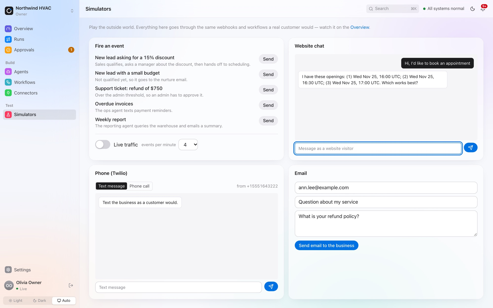<br><b>Simulators.</b> Play the outside world: fire events, chat as a website visitor, text or email the business, or switch on live traffic.</td>
<td>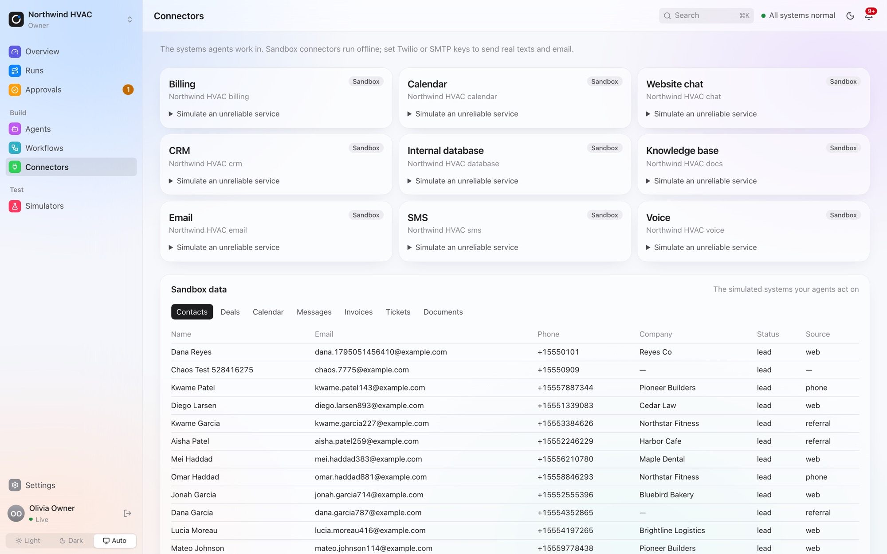<br><b>Connectors.</b> CRM, calendar, billing, email, SMS, voice and the internal database. Each one runs offline as a sandbox until real credentials are set.</td>
</tr>
<tr>
<td>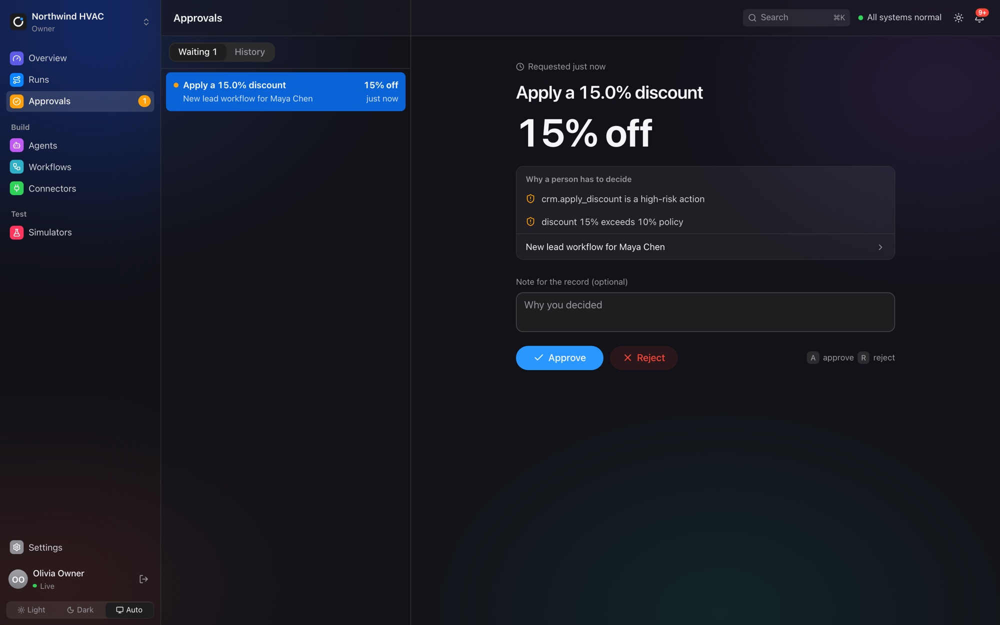</td>
<td>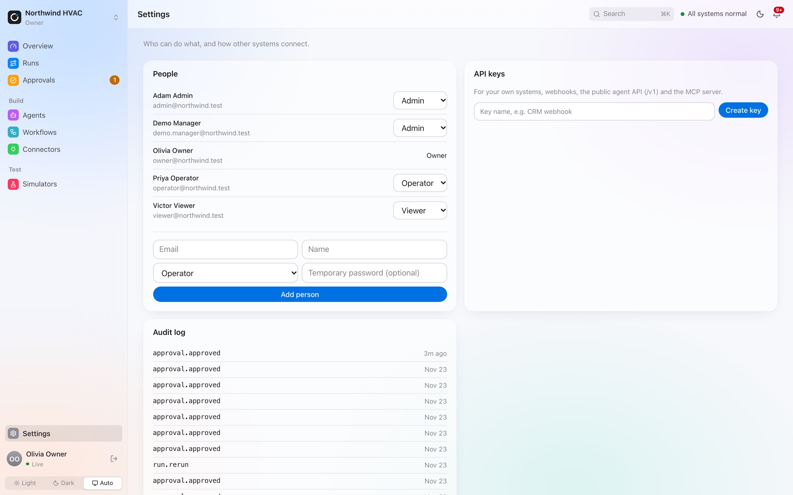<br><b>Settings.</b> People and roles, API keys for the public agent API and the MCP server, and the audit log.</td>
</tr>
<tr>
<td>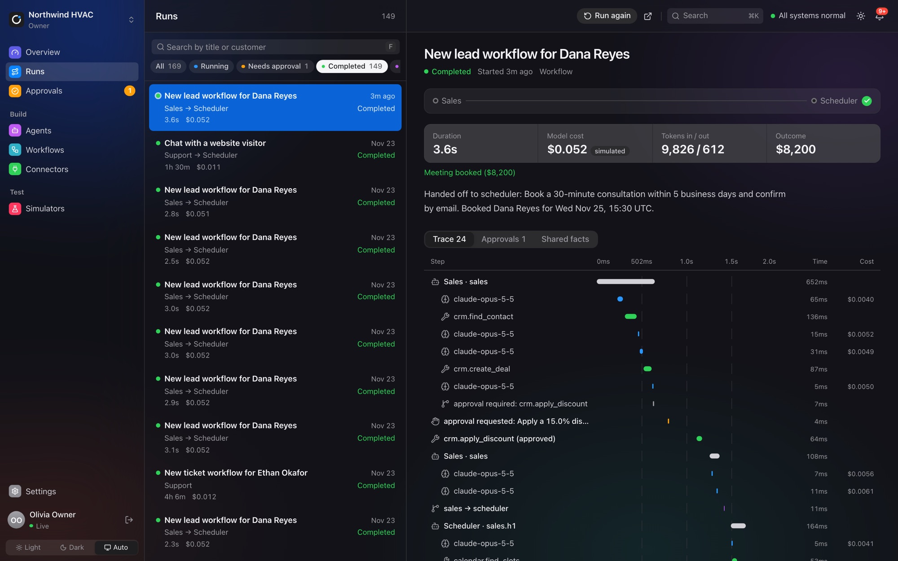</td>
<td>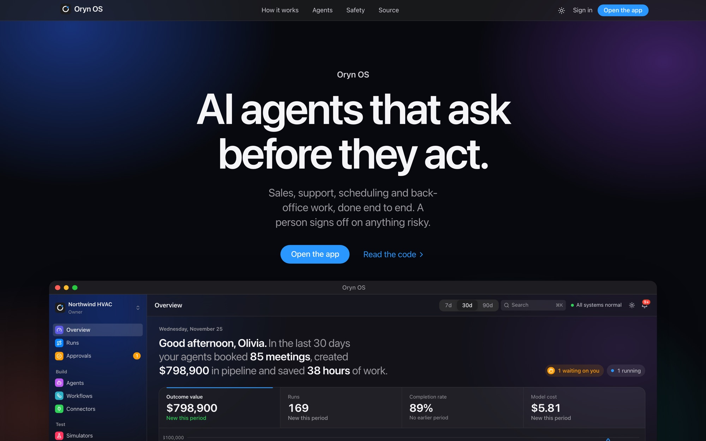</td>
</tr>
<tr>
<td>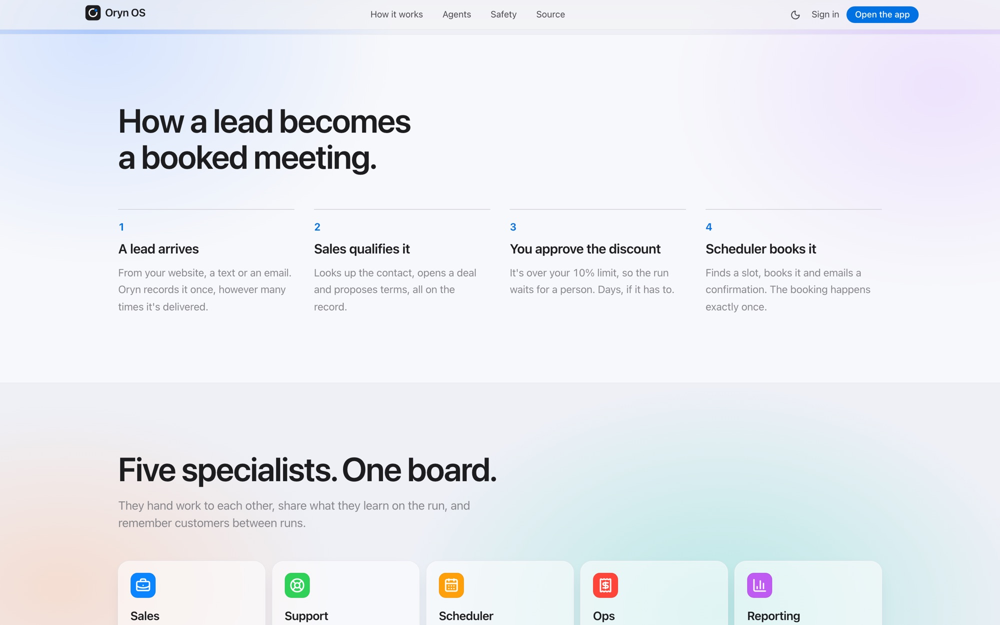</td>
<td>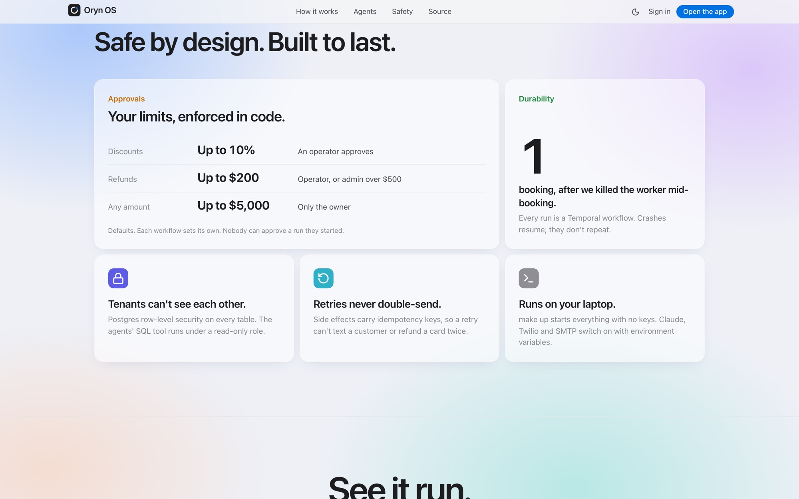</td>
</tr>
</table>

## Quickstart

Requirements: Docker (with Compose v2). Nothing else.

```bash
make up
```

Then open **http://localhost:5173**. The website embeds the running dashboard; *Open the app* takes
you to sign in (`owner@northwind.test` / `oryn-demo`).

`make up` builds the images, migrates the database, starts Postgres, Redis, Temporal, the API, the
worker and the web app, and starts generating **two weeks of history by actually running the
workflows** (about 300 runs; the Overview fills up within a couple of minutes, on a separate queue so
the demo stays responsive meanwhile). The stack uses about 1 GB of RAM.

| Sign in as | Can |
|---|---|
| `owner@northwind.test` | everything, including people and API keys |
| `admin@northwind.test` | edit agents, workflows, connectors; approve refunds up to the admin limit |
| `operator@northwind.test` | fire events, approve everyday actions |
| `viewer@northwind.test` | look around |
| `owner@brightsmile.test` | a second, fully isolated tenant (a dental practice) |

Password for every demo account: `oryn-demo` (local demo only).

**Five minutes to see what it does:** [docs/demo.md](docs/demo.md). The short version:

1. *Simulators → "New lead asking for a 15% discount"*. Watch it appear on the Overview board.
2. Sign in as the admin in another window, approve the discount under *Approvals*.
3. Open the run: the trace shows Sales qualifying, pausing for approval, handing off to Scheduler, and the booking.
4. `./scripts/chaos.sh` kills the worker in the middle of a booking and shows the run finishing anyway, with exactly one booking.

## What's inside

| Capability | How it's built |
|---|---|
| **Multi-agent collaboration** | Agents hand work to each other (`control.handoff`), share facts on a run blackboard, and remember customers across runs (pgvector memory). |
| **Durable orchestration** | Every run is a [Temporal](https://temporal.io) workflow interpreting a versioned workflow definition. Crashes, deploys and days-long approval waits don't lose work. |
| **Agent reasoning loop** | Each agent step is a [LangGraph](https://langchain-ai.github.io/langgraph/) state machine (think → act → think) running inside a single Temporal activity. |
| **Human approval controls** | A pure policy function decides which actions need a person and how senior; approvals wait durably, escalate up a role ladder, and auto-reject safely. |
| **Retries and recovery** | One error classifier decides retry vs. give up; side effects are idempotent; failed runs compensate (cancel bookings). |
| **Voice, SMS, email, chat, API agents** | Twilio SMS and voice webhooks (TwiML), inbound email, a website chat API and a public `/v1` agent API, all backed by one conversation workflow using Temporal Updates. |
| **Natural-language workflow builder** | "When a new lead arrives, have the sales agent qualify it…" compiles to a validated workflow graph (deterministic grammar offline, Claude when configured). |
| **Integrations** | CRM, calendar, billing, messaging, internal database and knowledge base behind typed interfaces: stateful sandbox implementations, plus real Twilio and SMTP. |
| **MCP** | An MCP server exposes a tenant's tools to any MCP client, with the same approval controls. |
| **Tenant isolation** | Postgres row-level security on every tenant table; the runtime database role cannot bypass it, cannot change its own tenant setting, and the agents' SQL tool runs under a narrower read-only role. |
| **RBAC and audit** | viewer, operator, admin and owner roles; role-gated approvals; no self-approval; an audit log of privileged actions. |
| **Central dashboard** | Live route board (each run drawn as the agents it passed through), execution traces with a time axis, tokens, cost and retries, an approvals queue, completion rates, cost, and business impact (meetings, pipeline, hours saved, return on model cost). |
| **Operator tools** | Every overview metric is compared with the previous period of the same length (relative change for amounts, percentage points for rates, and lower-is-better for latency). Any finished run can be **re-run** from the event that started it, on its workflow's current version, idempotently per `Idempotency-Key` and audited. An **activity feed** collects failures, escalations, approval requests and decisions, and outcomes, with unread state. A **system status** check reports Postgres, Redis, Temporal and whether workers are polling, with latencies. |
| **Keyboard-first UI** | A command menu (`⌘K`) that searches runs, pending approvals, agents and workflows server-side and runs actions (fire a test event, switch workspace, change theme); `G` then a letter to jump between pages; `J`/`K` through lists; `A`/`R` to approve or reject; `?` lists every shortcut. Light and dark themes. The dashboard uses the system typeface (SF Pro on Apple devices, with SF Rounded figures), grouped cards, translucent toolbars and a large title that collapses into the toolbar as you scroll. |

## Architecture

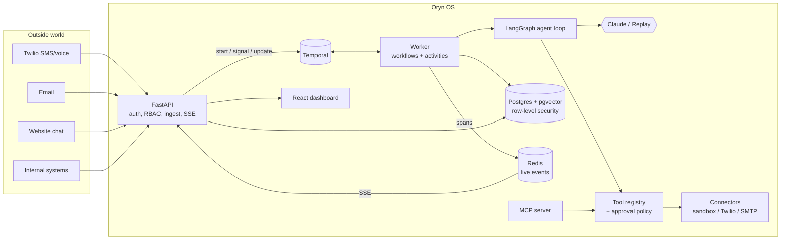

Read more in [docs/architecture.md](docs/architecture.md) and the decision records in [docs/adr](docs/adr).

### How a lead becomes a booked meeting

1. `POST /api/webhooks/{tenant}/events/lead.created` (or the simulator). The ingest stores the event idempotently and starts an `OrynRunWorkflow` per matching workflow.
2. The workflow runs the **Sales** agent step: an activity that opens one tenant-scoped transaction and runs the LangGraph loop. Sales looks up the contact, creates a deal, and proposes a 15% discount.
3. The discount is a high-risk tool over the 10% policy, so the loop **stops** and returns a pending action instead of applying it.
4. The workflow records an approval and waits durably. An admin approves, and the workflow executes the discount in a separate idempotent activity, then resumes Sales with the result.
5. Sales hands off to **Scheduler**, which finds a slot, books it, emails a confirmation and reports a `meeting_booked` outcome worth the deal value.
6. Every model call, tool call, decision and retry is a span, streamed live to the dashboard.

## Turn on real providers

Copy `.env.example` to `.env` and set what you need, then `make up` again.

| Variable | Effect |
|---|---|
| `LLM_PROVIDER=anthropic`, `ANTHROPIC_API_KEY` | Agents and the workflow builder use Claude (`claude-opus-5-5` by default, configurable per agent). Server-side refusal fallbacks are enabled. |
| `TWILIO_ACCOUNT_SID`, `TWILIO_AUTH_TOKEN`, `TWILIO_FROM_NUMBER`, `PUBLIC_BASE_URL` | Real SMS; inbound SMS/voice webhooks verify Twilio signatures. Point your number at `/api/webhooks/<tenant>/twilio/{sms,voice}`. |
| `SMTP_URL`, `SMTP_FROM` | Real outbound email. |
| `SANDBOX_FAILURE_RATE`, `SANDBOX_LATENCY_MS` | Make the sandbox systems flaky to watch retries (also adjustable per connector in the UI). |

Real senders still write to the sandbox outbox under the same idempotency key, so the dashboard shows
every message and a retry can never text a customer twice.

## Engineering

- **Tests:** 257 backend tests (pytest against real Postgres and Redis; Temporal workflows on the SDK's time-skipping test server), 23 frontend tests (Vitest), and a Playwright end-to-end test of the golden path against the running stack.
- **Static checks:** ruff, mypy (clean), TypeScript strict, ESLint. CI runs all of it plus image builds ([.github/workflows/ci.yml](.github/workflows/ci.yml)).
- **Chaos:** [scripts/chaos.sh](scripts/chaos.sh) kills the worker mid-step against the Docker stack and asserts the run completes with exactly one booking.
- **Bugs found by running it for real**, each fixed with a regression test first (write-ups in [docs/interview-guide.md](docs/interview-guide.md#bugs-found-by-running-the-system)):
  a connection-pool starvation under concurrent agent steps, a double booking when a handoff and an explicit workflow step targeted the same agent, a Temporal update racing its workflow's start, orphaned "running" spans after a crash, and the history backfill crowding out live demo traffic.
- **Final review:** a fresh review of the whole branch found, among others, a read-only SQL tool that could switch tenants and long chats hitting their caps; each fix has a regression test ([write-ups](docs/interview-guide.md#bugs-found-by-the-final-code-review)).

## Repository layout

```
backend/            Python 3.13, uv. Package `oryn`.
  oryn/api/         FastAPI app and routes (auth, runs, approvals, workflows, channels, metrics, SSE)
  oryn/orchestration/  Temporal workflows (run, conversation, MCP action), activities, approval loop
  oryn/agents/      LangGraph agent loop, prompts, step input/output models
  oryn/llm/         Claude provider, offline Replay provider, pricing
  oryn/tools/       Typed tool registry and catalog (risk metadata)
  oryn/policies/    Approval policy and escalation ladder
  oryn/connectors/  Interfaces, sandbox implementations, Twilio, SMTP, error classification
  oryn/workflows/   Workflow DSL and safe condition language
  oryn/builder/     Natural-language → workflow compiler
  oryn/memory/      pgvector memory store
  oryn/seed/        Demo tenants and history backfill
  migrations/       Alembic, including row-level security policies
  tests/
frontend/           React 19 + TypeScript + Vite + TanStack Query + Tailwind 4 + Recharts
deploy/             docker-compose.yml, Postgres init, Temporal config
scripts/            chaos.sh, wait-for-stack.sh
docs/               architecture, ADRs, demo script, interview guide, screenshots
```

## Local development

```bash
make infra          # Postgres, Redis, Temporal (+ UI on :8233)
make migrate
make api            # http://localhost:8800
make worker
make seed           # demo data + 14-day backfill (needs the worker running)
cd frontend && pnpm install && pnpm dev   # http://localhost:5173
make test
make lint
```

### The hosted demo

[oryn-os-silk.vercel.app](https://oryn-os-silk.vercel.app) is the same frontend built with
`VITE_DEMO=1`. In that build the API client answers from a recording of a real stack
(`frontend/src/demo/snapshot.json`) rather than the network. Timestamps shift to the present, a
simulated run replays a recorded run's trace and pauses for approval, and an in-browser event bus
stands in for the live stream. To refresh the recording and build it:

```bash
cd frontend
pnpm record:demo    # reads from a running API on :8800
pnpm build:demo     # static site in dist/, deployed by Vercel (see frontend/vercel.json)
```

## Limitations

This is a portfolio project, not a hosted product: there is no signup, SSO or billing; CRM, calendar
and billing integrations are sandbox implementations behind real interfaces (adding HubSpot, Google
Calendar or Stripe is one class each); and the offline Replay model follows scripted behavior per agent
role rather than reasoning. Everything else (orchestration, approvals, isolation, channels, metrics)
is the real code path in both modes.
